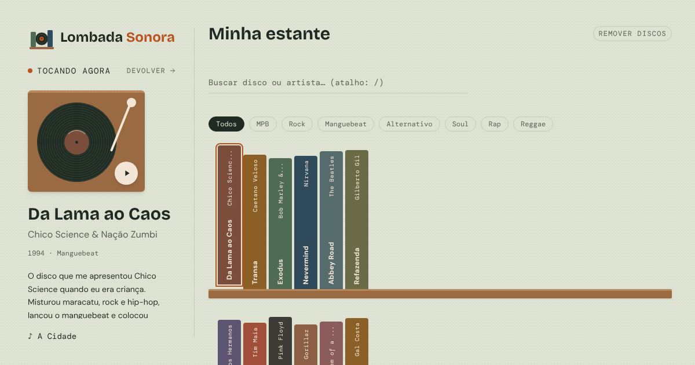

# Lombada Sonora

🇧🇷 [Leia em português](README.pt-BR.md)

A personal record collection where albums sit on a shelf showing only their spines, like a real collection at home. Pick one and it goes onto the turntable, where you can read a personal note about it and listen to a 30-second preview.

**[Live demo → lombada-sonora.vercel.app](https://lombada-sonora.vercel.app)**



> "Lombada" is Portuguese for the spine of a book or record, and "sonora" means "of sound". The interface is in Brazilian Portuguese.

## Features

- **Shelf of record spines** with varied heights and faded colors, split across shelves
- **Animated turntable** built only with CSS: the record drops in, the tonearm moves and the vinyl spins at 33⅓ rpm, only while the music is playing
- **Audio previews** from the iTunes Search API, with loading and unavailable states
- **Search and add records**, recognizing records already on the shelf even in remastered editions
- **Remove records** in a dedicated mode, with a confirmation dialog and an exit animation
- **Edit a record's note and genre**, with a draft that survives switching records by accident
- **Filter by genre**, using the project's own genre list instead of the store's
- **The collection is saved in the browser** and survives reloads, protected against corrupted data
- **Responsive layout**: on small screens a mini player stays at the bottom of the screen while you browse
- **Keyboard shortcut** (`/`) to focus the search

## Accessibility

Accessibility was part of every feature, not a final pass:

- Every control is a real `<button>`, `<input>` or `<select>`, usable with the keyboard alone
- Focus is managed on purpose: it returns to the record's spine after putting it back, moves to the right place after adding or removing a record, and stays trapped in the confirmation dialog
- Screen reader support with `aria-live` regions for the now-playing details and search results, `aria-pressed` for toggles and labels for icon-only buttons
- Keyboard order matches the visual order on every screen size
- Color contrast meets WCAG AA, checked with axe and by hand
- Animations respect `prefers-reduced-motion`, both in CSS and in JavaScript
- Works at 320px wide without horizontal scrolling

## Technical decisions

- **Derived state over duplicated state.** Only what can't be calculated is stored. The genre list, the visible records, the shelves and the "already on the shelf" labels are all computed from the collection.
- **Labeled async state.** Preview and search results are stored together with the record or term they belong to (`{ albumId, url }`, `{ term, results }`), so a late response can never show up for the wrong record.
- **An adapter for the API.** `services/itunes.js` is the only file that knows about iTunes. It translates store data, including genres, into the project's own format.
- **Previews are fetched when needed**, not when a record is added, so a temporary network failure never becomes permanent.
- **A `useLocalStorage` hook** works like `useState`, but loads from and saves to the browser, falling back to the initial collection when the saved data is missing or invalid.
- **Native elements first.** The confirmation uses `<dialog>` with `showModal()`, which already provides the backdrop, the `Esc` key and focus trapping.

## Challenges and what I learned

- **Out-of-order responses.** Clicking records quickly could let an old preview overwrite a new one. I solved it with the `ignore` flag in the effect cleanup and by labeling the stored data with the record's id.
- **CSS that fights itself.** A wobble animation silently won over the exit animation, leaving a record stuck in a "leaving" state. Finding it taught me to ask what should have released a stuck state and why it didn't.
- **Focus that disappears.** When an element that has focus leaves the screen, focus falls back to the top of the page. Each case (returning a record, adding, removing) needed its own plan.
- **Filters pointing to genres that no longer exist.** Removing or editing the last record of a genre left the shelf empty. The fix was a single rule in the right place: when the chosen genre disappears, the choice is forgotten.
- **Responsive details that only show up on a real phone**, like iOS zooming into inputs smaller than 16px.

The whole process, session by session, is documented (in Portuguese) in the [development journal](docs/diario.md).

## Tech stack

- React 19
- Tailwind CSS v4
- Vite
- iTunes Search API
- Deployed on Vercel

## Running locally

```bash
git clone https://github.com/diegoandradelr/lombada-sonora.git
cd lombada-sonora
npm install
npm run dev
```

## Project structure

```
src/
├── components/   UI components, one folder each
├── data/         initial collection, genres and spine colors
├── hooks/        useLocalStorage
├── services/     iTunes API adapter
└── utils/        small pure functions (chunk, getGenres, isSameAlbum, random)
```

## Author

Made by **Diego Andrade**. [GitHub](https://github.com/diegoandradelr)
