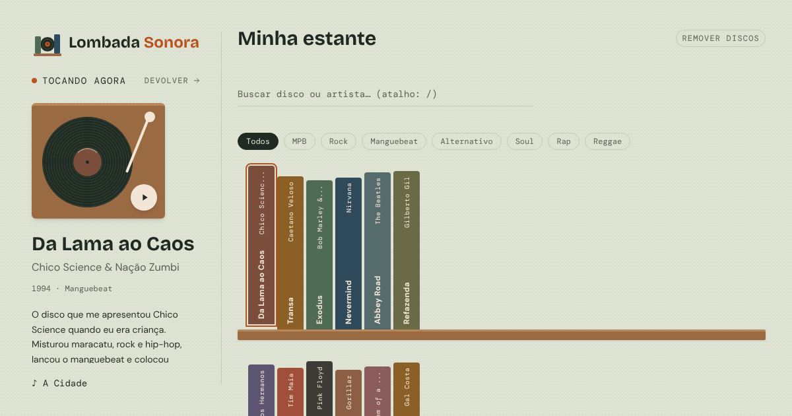

# Lombada Sonora

🇺🇸 [Read in English](README.md)

Uma coleção pessoal de discos em que os álbuns ficam numa estante mostrando só as lombadas, como uma coleção de verdade em casa. Escolha um e ele vai para o toca-discos, onde dá para ler uma nota pessoal sobre ele e ouvir uma prévia de 30 segundos.

**[Ver o projeto no ar → lombada-sonora.vercel.app](https://lombada-sonora.vercel.app)**



## Funcionalidades

- **Estante de lombadas** com alturas variadas e cores desbotadas, dividida em prateleiras
- **Toca-discos animado** feito só com CSS: o disco pousa, o braço desce e o vinil gira a 33⅓ rpm, só enquanto a música toca
- **Prévias de áudio** da API de busca do iTunes, com estados de carregando e indisponível
- **Buscar e adicionar discos**, reconhecendo os que já estão na estante, até em edições remasterizadas
- **Remover discos** num modo próprio, com um modal de confirmação e uma animação de saída
- **Editar a nota e o gênero de um disco**, com um rascunho que sobrevive à troca de disco por engano
- **Filtrar por gênero**, usando uma lista de gêneros própria do projeto, e não a da loja
- **A coleção é salva no navegador** e continua lá depois de recarregar a página, protegida contra dados corrompidos
- **Layout responsivo**: em telas pequenas, um mini player fica preso no pé da tela enquanto você navega
- **Atalho de teclado** (`/`) para ir direto à busca

## Acessibilidade

A acessibilidade fez parte de cada funcionalidade, e não foi uma revisão no fim:

- Todo controle é um `<button>`, `<input>` ou `<select>` de verdade, e funciona só com o teclado
- O foco é controlado de propósito: volta para a lombada do disco ao devolvê-lo, vai para o lugar certo depois de adicionar ou remover um disco e fica preso dentro do modal de confirmação
- Suporte a leitores de tela, com regiões `aria-live` para a ficha do disco tocando e para os resultados da busca, `aria-pressed` nos botões que ligam e desligam e rótulos nos botões que só têm ícone
- A ordem do teclado acompanha a ordem visual em todos os tamanhos de tela
- O contraste das cores atende o nível AA da WCAG, conferido com o axe e à mão
- As animações respeitam o "reduzir movimento" (`prefers-reduced-motion`), tanto no CSS quanto no JavaScript
- Funciona em telas de 320px de largura, sem rolagem lateral

## Decisões técnicas

- **Estado calculado em vez de estado duplicado.** Só é guardado o que não dá para calcular. A lista de gêneros, os discos visíveis, as prateleiras e os avisos de "Na estante" são todos calculados a partir da coleção.
- **Estado assíncrono com etiqueta.** As prévias e os resultados da busca são guardados junto com o disco ou o termo a que pertencem (`{ albumId, url }`, `{ term, results }`), para que uma resposta atrasada nunca apareça no disco errado.
- **Um adaptador para a API.** O `services/itunes.js` é o único arquivo que conhece o iTunes. Ele traduz os dados da loja, inclusive os gêneros, para o formato do projeto.
- **As prévias são buscadas na hora de tocar**, e não ao adicionar o disco, para que uma falha momentânea de internet nunca vire permanente.
- **Um hook `useLocalStorage`** funciona como o `useState`, mas carrega e salva no navegador, e volta para a coleção inicial quando o dado salvo não existe ou é inválido.
- **Elementos nativos primeiro.** A confirmação usa o `<dialog>` com `showModal()`, que já traz o fundo escurecido, a tecla `Esc` e o foco preso dentro dele.

## Desafios e aprendizados

- **Respostas fora de ordem.** Clicando rápido nos discos, a prévia de um disco antigo podia sobrescrever a do novo. Resolvi com a variável `ignore` na limpeza do efeito e guardando o `id` do disco junto com os dados.
- **CSS brigando com ele mesmo.** A animação de balançar vencia a animação de saída sem dar nenhum erro, e o disco ficava preso no estado "saindo". Encontrar o problema me ensinou a perguntar o que deveria ter liberado um estado preso, e por que isso não aconteceu.
- **Foco que desaparece.** Quando o elemento que tem o foco sai da tela, o foco volta para o topo da página. Cada caso (devolver, adicionar e remover um disco) precisou de um plano próprio.
- **Filtros apontando para gêneros que não existem mais.** Remover ou editar o último disco de um gênero deixava a estante vazia. A solução foi uma única regra no lugar certo: quando o gênero escolhido some, a escolha é esquecida.
- **Detalhes do celular que só aparecem num aparelho de verdade**, como o iPhone dando zoom em campos de texto com letra menor que 16px.

Todo o processo, sessão por sessão, está registrado no [diário de desenvolvimento](docs/diario.md).

## Tecnologias

- React 19
- Tailwind CSS v4
- Vite
- API de busca do iTunes
- Publicado na Vercel

## Como rodar no seu computador

```bash
git clone https://github.com/diegoandradelr/lombada-sonora.git
cd lombada-sonora
npm install
npm run dev
```

## Estrutura de pastas

```
src/
├── components/   componentes da interface, um por pasta
├── data/         coleção inicial, gêneros e cores das lombadas
├── hooks/        useLocalStorage
├── services/     adaptador da API do iTunes
└── utils/        funções pequenas e puras (chunk, getGenres, isSameAlbum, random)
```

## Autor

Feito por **Diego Andrade**. [GitHub](https://github.com/diegoandradelr)
